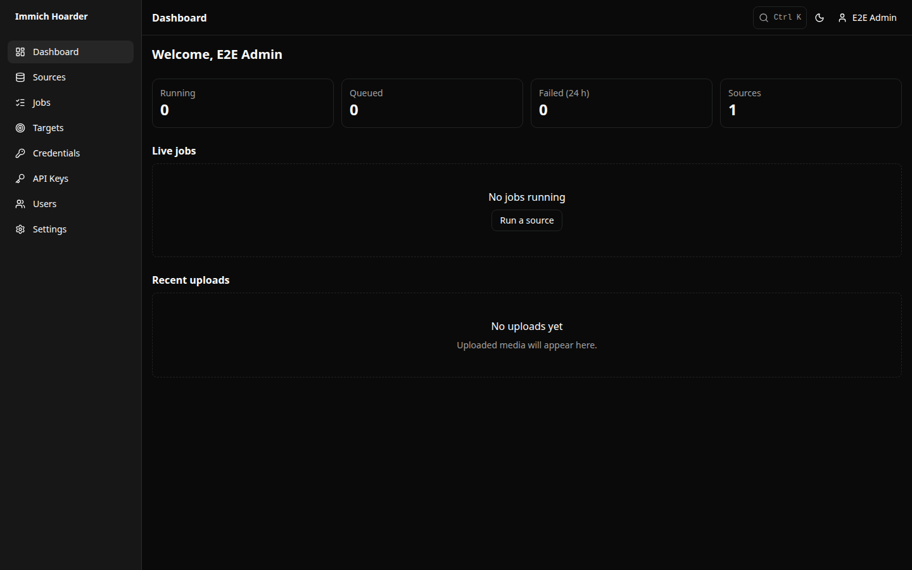
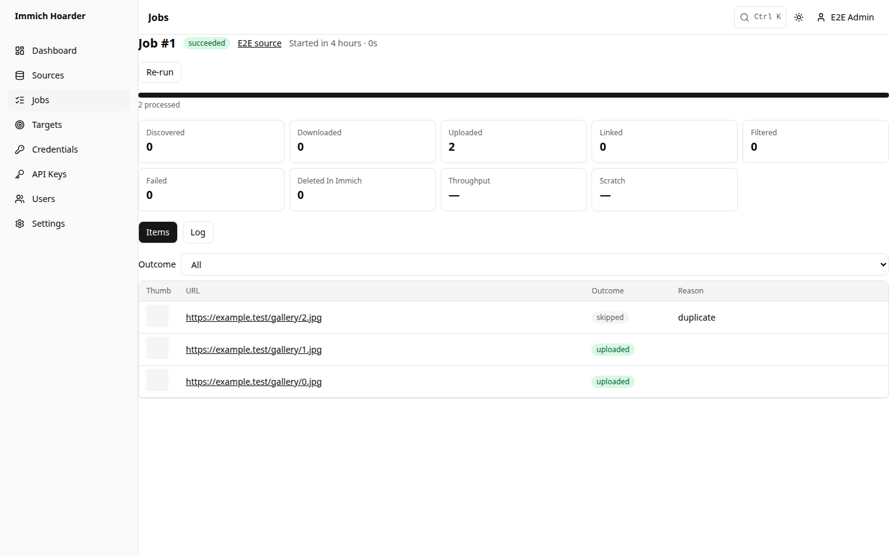

# immich-hoarder

immich-hoarder fetches images from sites supported by [gallery-dl](https://github.com/mikf/gallery-dl) and uploads them to your [Immich](https://immich.app) server. Add a source URL, pick a target and a schedule, and it keeps your library up to date, skipping what you already have. It ships as a single container with a web UI.

## Features

- gallery-dl sources: any site gallery-dl supports, images only
- Schedules (cron) and backfill modes (full, last N, since a date)
- Per-target dedupe with SHA-1 and perceptual hash (pHash), so duplicates are linked, not re-uploaded
- Albums from templates such as `Reddit/{subreddit}`, plus descriptions from post metadata
- Filters: size, aspect ratio, title regex, date range and more
- OIDC sign-in, scoped API keys and per-resource sharing
- Live job telemetry: dashboard, per-job log viewer and item results
- Notifications via Apprise (global or per source)
- Proxy support, including a gluetun VPN override
- Backups (SQLite snapshots, config export/import) and an optional PostgreSQL database





## Quickstart

Image: `ghcr.io/metril/immich-hoarder`. You need Docker with Compose, an external `traefik` network, and an OIDC provider (details in the [install guide](https://metril.github.io/immich-hoarder/install/)).

```bash
# 1. secrets (also paste your OIDC client secret into secrets/ih_oidc_client_secret)
mkdir secrets && openssl rand -base64 48 > secrets/ih_master_key && openssl rand -base64 48 > secrets/ih_session_secret
# 2. get the compose file, then set your hostname, OIDC issuer and OIDC client ID in it
curl -fsSLO https://raw.githubusercontent.com/metril/immich-hoarder/main/compose.example.yml
# 3. start
docker compose -f compose.example.yml up -d
# 4. open https://hoarder.example.com (your hostname)
# 5. sign in with your OIDC provider
```

## Documentation

- [Documentation site](https://metril.github.io/immich-hoarder/)
- API reference: `/api/docs` on your instance
- [Contributing](CONTRIBUTING.md)

## License

Proprietary. All rights reserved; the source is visible for reference only. See [LICENSE](LICENSE).
