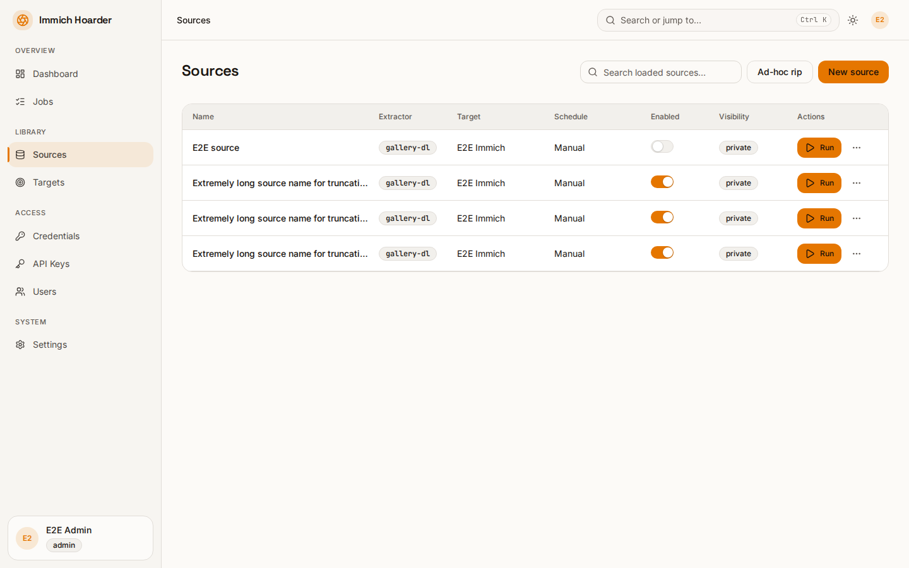
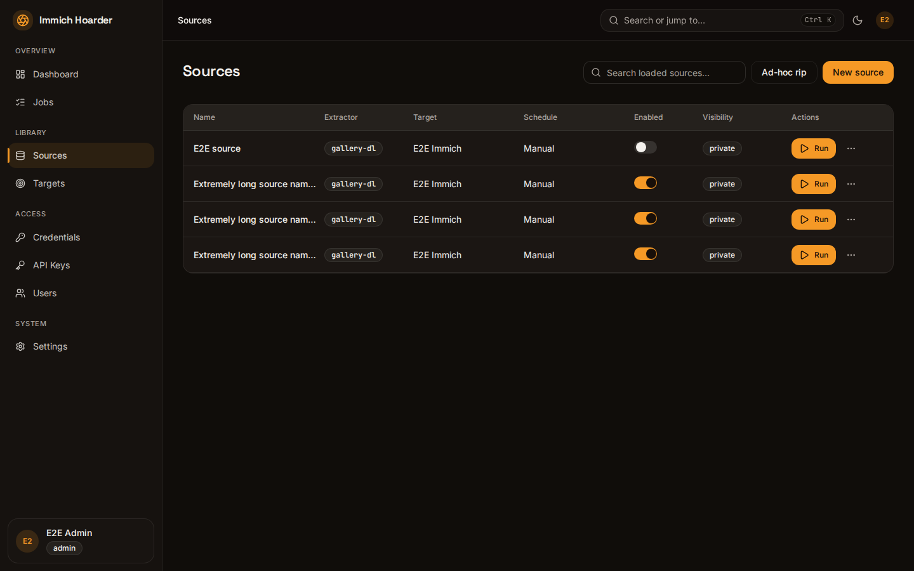
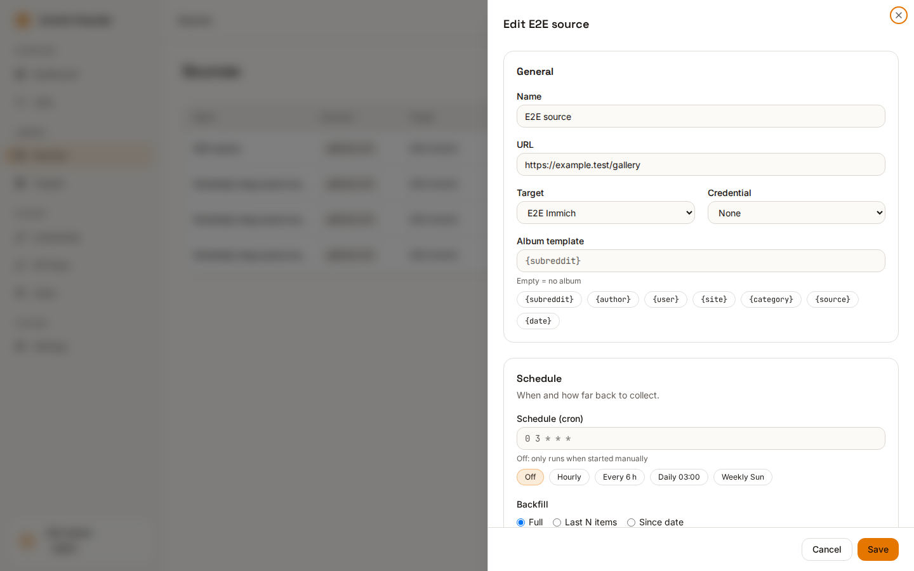
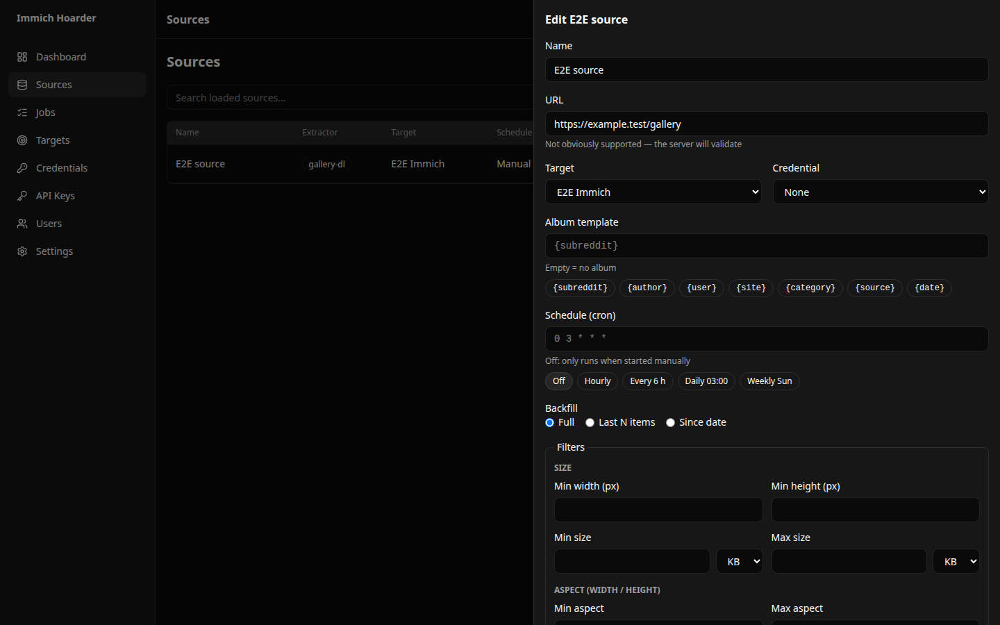
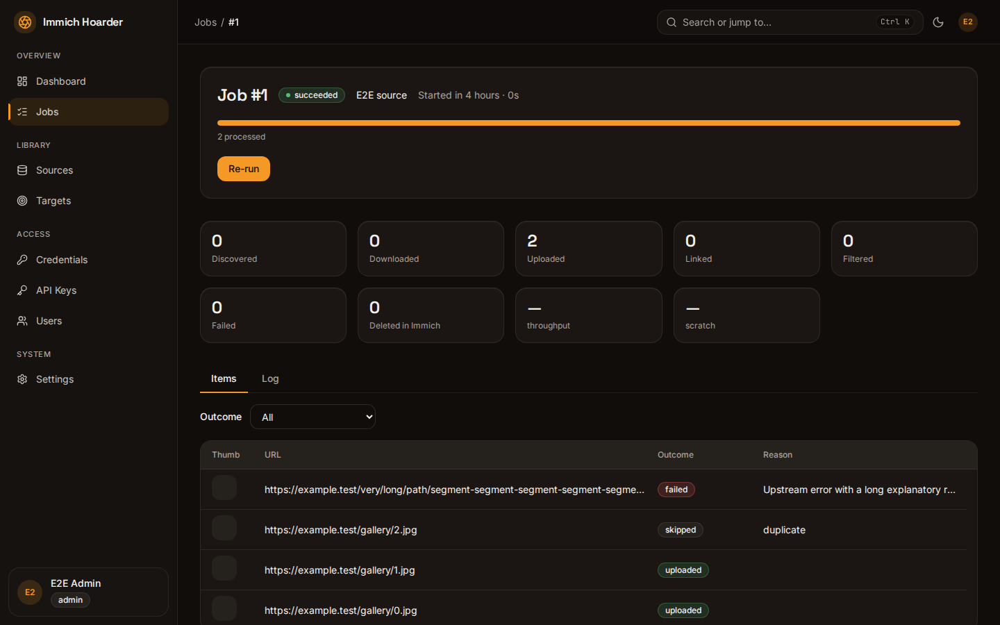
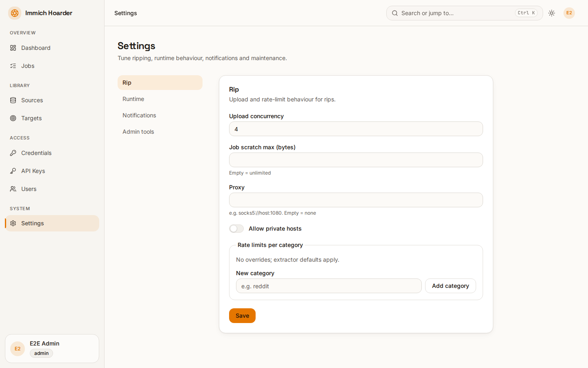
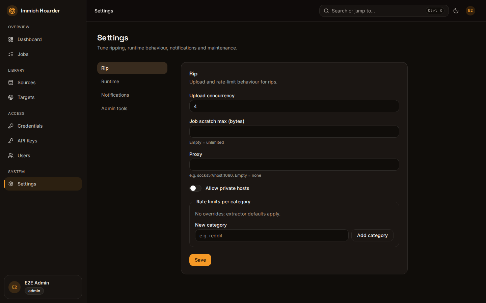
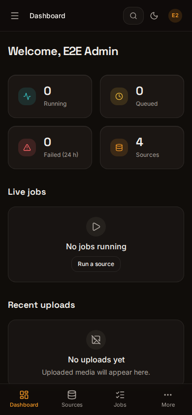

# Web GUI

Sign in with your OIDC provider. Admins also see the Users and Settings pages. Use the theme toggle in the top bar to choose light, dark or system; the choice is remembered in your browser.

## Dashboard

Live view of running and queued jobs and recent results. It updates over a server-sent event stream, so no refresh is needed.

=== "Light"
    
=== "Dark"
    

## Sources

A source is a URL to fetch from, plus the Immich target it uploads to. The list shows the sources you own or that were shared with you. Use **New** to create one, or open a row to edit it. The editor has a dry-run **Preview** panel; see [Sources](sources.md).

=== "Light"
    
=== "Dark"
    

=== "Editor, light"
    
=== "Editor, dark"
    

## Jobs and the log viewer

Each run of a source is a job. The Jobs page lists them; a job's detail page shows its status, counters (downloaded, uploaded, linked, filtered, `deleted_in_immich`, failed), the per-item results and a live log viewer with a minimum-level filter. You can cancel an active job or retry a finished one.

=== "Light"
    
=== "Dark"
    

## Targets

An Immich server (URL plus API key). **Test** checks the connection and reports the Immich version and any API-key permissions that are missing. Targets can be shared like sources. A target that a source uses cannot be deleted.

## Credentials

Secrets stored encrypted with `MASTER_KEY`: site logins (`oauth`, `cookies`, `userpass`, `token`) used by sources, and `apprise` notification URLs. Secret values are never shown again after saving.

## API Keys

Create, list and revoke your keys. The full key is shown once, at creation. See [API](api.md).

## Users

Admin only. Lists users that have signed in, with their role and groups, and lets an admin disable a user. Roles come only from OIDC groups.

## Settings

Admin only. Proxy and rate limits, upload concurrency, per-job scratch limit and `allow_private_hosts`; retention, backup schedule, concurrency and cancel grace; global notification URLs; backups, pruning and config import/export. All keys are in the [configuration reference](reference/configuration.md).

=== "Light"
    
=== "Dark"
    

## Command palette and shortcuts

Press Ctrl+K (⌘K on macOS) for the command palette: jump to any page or search sources. Press `?` for the shortcut list.

| Keys | Action |
|---|---|
| ⌘K / Ctrl K | Command palette |
| `?` | Shortcut help |
| `/` | Focus search |
| `n` | New item (on list pages) |
| `g d` | Go to Dashboard |
| `g s` | Go to Sources |
| `g j` | Go to Jobs |
| `g t` | Go to Targets |
| `g c` | Go to Credentials |
| `g k` | Go to API Keys |
| `g u` | Go to Users (admin) |
| `g ,` | Go to Settings (admin) |

Plain-key shortcuts are ignored while you type in a form field. For `g` shortcuts, press the second key within one second.

## Mobile

Below the medium breakpoint the sidebar collapses into a menu button that opens a slide-out navigation sheet. Every page is usable on a phone.

{ width="320" }
