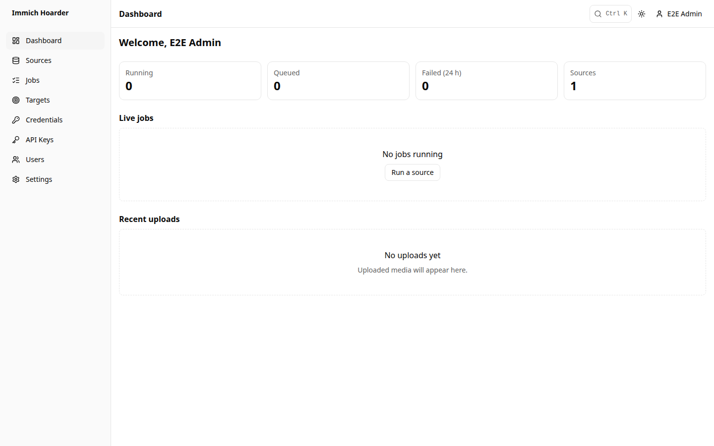

# immich-hoarder

immich-hoarder downloads images from gallery sources with gallery-dl and uploads them to your [Immich](https://immich.app) server. It runs as a single container with a web UI, a REST API and per-user credentials.

## Features

- Sources: define gallery URLs and download them on a schedule or on demand.
- Immich upload with de-duplication: bytes already uploaded, or deleted on the Immich side, are not uploaded again.
- Web GUI with a live dashboard, job detail and a source editor.
- Notifications through Apprise, per user and global.
- Egress control: private-address guard and optional proxy or VPN (gluetun).
- OIDC single sign-on with role mapping from groups; API keys with scopes.
- SQLite by default, PostgreSQL optional.
- Encrypted stored credentials; secrets via Docker secrets.

## Where to start

1. [Install](install.md) behind Traefik.
2. [Set up Authentik](authentik.md) for login.
3. Review the [configuration reference](reference/configuration.md) and [security notes](security.md).
